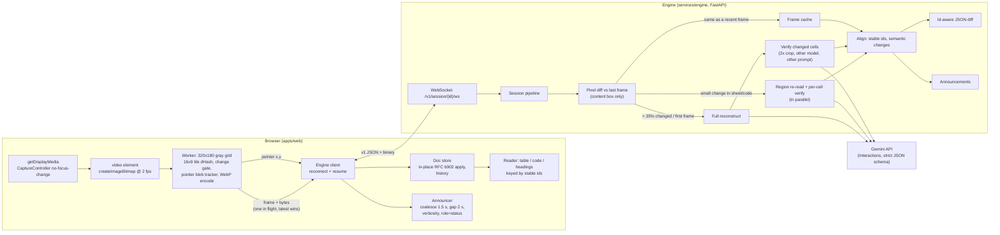

# Architecture

## Why there is a backend

- **The API key stays off the client.** Browsers never see it.
- **One authoritative version.** The engine owns the document, mints ids and computes diffs, so a reconnecting client resumes from a version number instead of rebuilding.
- **Caching.** Recent frames are compared pixel-wise; flipping back to an earlier screen (a blinking caret, an undo) costs no model call.
- **Verification.** Every changed value is read twice, by a different model with a differently worded prompt on a tight 2× crop. Disagreement makes the value `uncertain`, which is shown but announced only as "possibly changed, unclear".
- **Metering.** Token counts and cost are recorded per call and per purpose.

## The document model is the contract

`engine/model/document.py` (Pydantic) is the single source of truth. `python -m engine.model.export` writes `packages/schema/unscreen.schema.json`, and `json-schema-to-typescript` turns it into `packages/schema/unscreen.d.ts`, which the web app imports. CI regenerates both and fails on any difference.

The vision model never sees or produces ids. Its response schema (`engine/llm/schemas.py`) is deliberately small: plain strings, coordinate ranges, and a list of only the cells it could not read clearly. The aligner (`engine/pipeline/align.py`) matches each new read to the previous version, by row key and header text first and similarity second, and carries ids forward. Ids are minted once per session and never regenerated, which is what lets the browser update one text node instead of rebuilding the table.

## Why the reading position survives an update

1. The engine sends RFC 6902 operations against stable ids: an edited cell is one `replace` on `/sheet/rows/3/cells/2/text`.
2. The browser applies them in place to a Svelte `$state` proxy (`apps/web/src/lib/doc/patch.ts`). It never swaps the document object.
3. Rows and cells render in keyed `{#each}` blocks, so Svelte updates the one text node that changed and inserts or removes only the rows that changed.
4. No ancestor of the screen reader's position is replaced, so NVDA's browse-mode buffer and focus stay where they were. A Playwright test holds focus on a cell through 20 patches and checks the element identity.

## Change detection, both sides

- **Browser:** a 320×180 grayscale grid hashed per tile. A frame is sent only when it differs from the last frame sent and has been still for 300 ms, so no mid-scroll frames go out. Two small blobs that swap places, far apart, are the presenter's pointer: they are reported as a pointer position, not sent as a frame.
- **Engine:** an exact pixel-block diff inside the content box decides between full and region reads and finds the changed rectangle.

## Failure behaviour

| What happens | What the user hears or sees |
| --- | --- |
| Model call fails | "Could not read that frame. Trying again with the next change." Nothing is announced as content. |
| Repeated failures | The breaker opens: "Content unchanged, engine busy." The last version stays on the page. |
| Connection drops | Reconnects with backoff (0.5 s to 10 s) and resumes from the last version; a snapshot is sent if versions differ. |
| Session expired | A new session starts and a fresh frame is sent. |
| Share stopped or tab closed | Assertive alert: "Sharing ended. Press Start to read again." |
| Permission denied | "Sharing was cancelled or blocked. Press Start and choose the meeting tab or window." |
